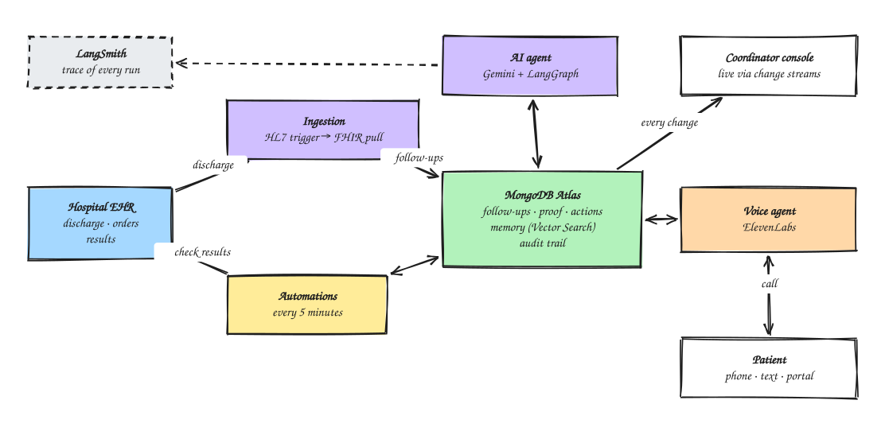
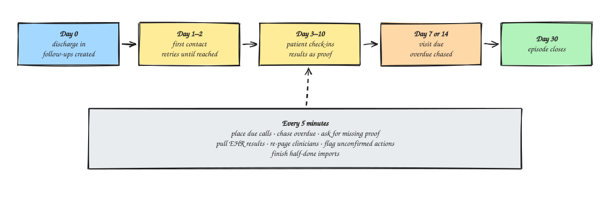
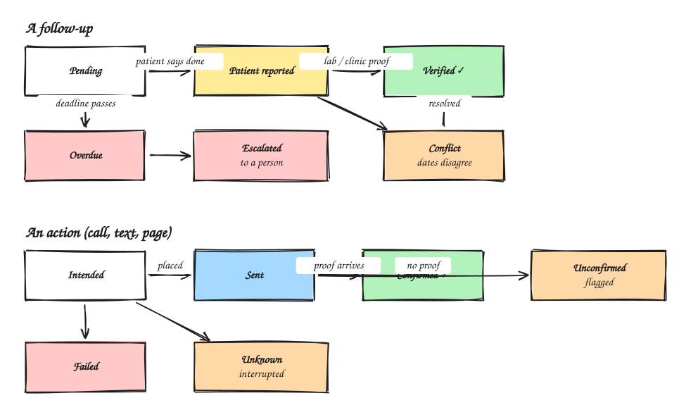
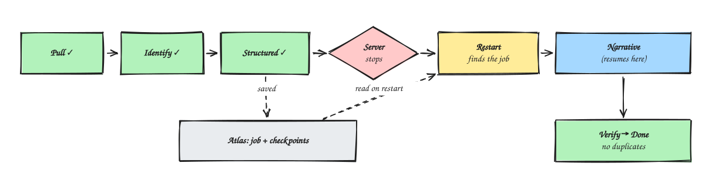

# Continuum

**An AI agent that finishes the 30 days after hospital discharge.**

**Live:** https://continuum-production-531572b1.up.railway.app · **Video:** [1-minute demo](https://youtu.be/Ap8-p4yq5gM) · **Try the console in one click:** [/demo](https://continuum-production-531572b1.up.railway.app/demo) (synthetic patients, no sign-up)

Built for **Statement Three: Finish the Job** at MongoDB *Agents in Context*, Toronto 2026.

---

## The problem

Every discharge comes with a plan: see your family doctor within a week, repeat the bloodwork, a nurse will visit. Nobody owns making sure it happens.

- About **1 in 7** US hospital stays is followed by a readmission within 30 days, a rate that held steady every year from 2016 to 2020 ([AHRQ HCUP Statistical Brief #304, 2023](https://hcup-us.ahrq.gov/reports/statbriefs/sb304-readmissions-2016-2020.jsp)).
- **More than half** of Medicare patients don't see a clinician within 7 days of leaving hospital: only 43.6% of 749,402 patients did ([Journal of General Internal Medicine, 2022](https://acphospitalist.acponline.org/archives/2022/04/06/free/timely-follow-up-after-hospitalization-may-reduce-disparities-in-readmissions.htm)).

The follow-up is spread across hospitals, clinics, labs and phone calls, and everyone assumes someone else has it.

## What Continuum does

1. **Reads the discharge** straight from the hospital's record system and turns the plan into follow-ups with owners and deadlines.
2. **Calls the patient** with a voice agent, and saves what they say as their report, not as fact.
3. **Chases what's late** every few minutes: overdue visits, missing results, unanswered calls.
4. **Closes a follow-up only with proof**, such as a lab result from the EHR or a clinic confirmation.
5. **Shows the care team only what needs a person**, and asks before anything sensitive.

## Architecture

<p align="center"></p>

Everything shares one source of truth in Atlas. The console never polls for changes: change streams push every write to it as it happens.

## How one discharge flows

<p align="center"></p>

<p align="center"></p>

<p align="center"></p>

## The agent

Two LangGraph agents work on the same Atlas data.

**Follow-up agent**: runs on every document, call transcript and patient report.

<p align="center"></p>

- **extract**: Gemini pulls follow-ups, dates and reports out of free text, with rules as a fallback.
- **retrieve**: patient memory from **Atlas Vector Search**, filtered to that patient only.
- **validate / propose**: matches reports to the right follow-up and proposes changes. A patient's word never closes anything.
- **await_approval**: a LangGraph `interrupt()`. Sensitive changes pause, checkpointed in Atlas (`MongoDBSaver`), until a person decides.

**Console assistant**: "Ask Continuum" in the console. It's a tool-calling agent over the same data that answers with cards (who needs me, a patient's record, the last call, unconfirmed actions) and navigates for you. Anything that changes data comes back as a card with **Confirm**, run under your name.

## Built for "Finish the Job"

| The brief asks | What Continuum does |
|---|---|
| A long, multi-step task across several systems | 30 days of follow-up across the EHR (HL7 + FHIR), phone calls (ElevenLabs + Twilio), texts and portal, and the care team's console |
| Atlas holds verified task state | Follow-ups, evidence, every outbound action and its outcome, the audit trail and agent checkpoints, with `$jsonSchema` validation |
| Vector Search for past experience | Per-patient memory, and new hospital orders matched to ones seen before |
| Tell an action that took effect from one only sent | **Action ledger**: `intended → sent → confirmed`, or `unconfirmed / failed / unknown`, reconciled every sweep. A call is confirmed only by its transcript. |
| Resume after a crash without replaying history | **Checkpointed ingestion jobs** with leases. A killed job resumes at the next step on restart, and change streams resume from a saved token. |
| Adapt when a system changes underneath it | **Order memory**: a referral under a new code or wording is matched by meaning, and a coordinator's correction is remembered. |

### Statement Three's three questions

**1. How does it tell an action that took effect from one that was only sent?**
Every outbound action goes into an action ledger: `intended → sent → confirmed`. A call is *confirmed* only when its transcript arrives; one with no proof is flagged `unconfirmed`, never assumed done. A patient saying "it's done" stays *patient-reported* until a lab result or clinic note proves it.

**2. How does it resume after a crash without replaying its whole history?**
Each hospital import is a job saved to Atlas after every step (pull, identify, structured, narrative, verify). On restart, Continuum finds the unfinished job, sees which steps are saved, and continues from the next one. Agent runs resume from LangGraph checkpoints in Atlas.

**3. How does it adapt when a system's layout, fields or workflow change?**
When a hospital sends an order under a new code or wording, Continuum matches it to orders it has seen before by meaning, with Atlas Vector Search. When a coordinator corrects a match, that correction is remembered for next time.

### The three hard parts

<p align="center"></p>

<p align="center"></p>

<p align="center"></p>

## How it's built

| Part | What it does | Code |
|---|---|---|
| **EHR ingestion** | HL7 ADT^A03 over MLLP or HTTP triggers a FHIR R4 pull; a checkpointed job builds follow-ups in five steps | `backend/app/ingest/` (`hl7.py`, `mllp.py`, `pull.py`, `builder.py`, `jobs.py`) |
| **Result poller** | Asks the EHR for lab results and appointment changes behind open follow-ups and attaches them as evidence | `ingest/poller.py` |
| **Order memory** | Matches unfamiliar order codes by meaning with Atlas Vector Search; remembers coordinator corrections | `ingest/orders.py` |
| **Follow-up agent** | LangGraph graph: extract → retrieve memory → validate → propose → pause for approval, checkpointed in Atlas | `backend/app/agent/` (`graph.py`, `extraction.py`, `memory.py`, `checkpoint.py`) |
| **Action ledger** | Every outbound action recorded before it's sent: `intended → sent → confirmed / unconfirmed / failed / unknown` | `ledger.py` |
| **Automations** | A sweep every 5 minutes: due calls, overdue chasing, missing proof, EHR polling, re-paging, resuming imports | `scheduler.py` |
| **30-day clock** | Contact within 2 business days, visit within 7 or 14 days, episode closes at 30 | `tcm.py`, `episodes.py` |
| **Voice** | ElevenLabs agent with 7 signed tools, real calls through a Twilio number, transcripts back by webhook | `routes/voice.py`, `calls.py`, `scripts/create_voice_agent.py` |
| **Text, email, portal check-ins** | A link to a check-in page gated by date of birth | `messaging.py`, `routes/portal.py` |
| **Console assistant** | Tool-calling agent streamed over SSE; answers with cards, asks before acting | `assistant.py`, `frontend/src/assistant/` |
| **Live console** | MongoDB change streams pushed to the browser over server-sent events | `streams.py`, `routes/live.py` |
| **Data layer** | Atlas collections with `$jsonSchema` validators, indexes and two Vector Search indexes | `db.py`, `atlas_setup.py` |

## LangSmith

Every agent run is traced to the `continuum-hackathon` project: the follow-up agent's graph steps, each Gemini call, and every console-assistant conversation with its tool calls. A reviewer can open any change in Continuum and see what the agent read, which memory it pulled, and why it proposed what it did.

## Safety

- Discloses that it's an AI, asks consent to record, and verifies name and date of birth before any care is discussed.
- Never gives clinical advice. Medication and symptom questions go to a clinician, and emergencies get "call 911" plus an escalation.
- Coordinators approve bookings, closures and record changes. Every action is attributed and audited.

## Tech stack

- **MongoDB Atlas**: Vector Search, change streams, schema validation
- **LangGraph + LangChain**: the agents and their checkpoints
- **Gemini**: the LLM (any provider works with an API key)
- **Voyage AI**: embeddings
- **ElevenLabs Conversational AI**: the voice agent
- **Twilio**: the phone number for real calls
- **LangSmith**: tracing
- **FastAPI**: the backend
- **React + assistant-ui**: the console and its assistant
- **HL7v2 / FHIR R4**: the hospital's record system
- **Railway**: hosting

## Run it locally

```bash
cd backend && python3.12 -m venv .venv && .venv/bin/pip install -r requirements.txt
cp ../.env.example ../.env            # add MONGODB_URI, LLM_PROVIDER/LLM_API_KEY, optional ElevenLabs + LangSmith
.venv/bin/python -m app.atlas_setup   # indexes, validators, Vector Search, demo data
.venv/bin/python -m app.keys_check    # checks every key and connection
.venv/bin/uvicorn app.main:app --port 8000
cd ../frontend && npm ci && npm run build   # served by the API at http://localhost:8000
```

Tests: `cd backend && .venv/bin/python -m pytest -q`

Diagrams are Excalidraw files in [`docs/diagrams/`](docs/diagrams): open any `.excalidraw` file on excalidraw.com to edit it.

More detail: [docs/ingestion.md](docs/ingestion.md) · [docs/atlas.md](docs/atlas.md) · [docs/elevenlabs-setup.md](docs/elevenlabs-setup.md) · [docs/demo-runbook.md](docs/demo-runbook.md) · [docs/security-review.md](docs/security-review.md)

## Technical demo

- **Video (1 min):** [watch on YouTube](https://youtu.be/Ap8-p4yq5gM). A real phone call: Grace's missed post-discharge call tops the care team's queue, the voice agent calls her, verifies her identity and records her appointment for the clinic to verify.
- **Live app:** [open the console in one click](https://continuum-production-531572b1.up.railway.app/demo), no sign-up, synthetic patients.

**Try it in 3 minutes:**
1. **Needs you** opens on the most overdue work, each item with the reason and one action.
2. **Ask Continuum** (top right, or press `A`): "What needs me today?", "Who hasn't had bloodwork verified?", "Call Grace Thompson". Answers come back as cards; anything that changes data waits for **Confirm**.
3. Open a patient → **Call Room** → **Simulated** to watch a full check-in call update the record live.
4. **Actions** shows every call and message as `intended → sent → confirmed`.
5. **Imports** shows EHR discharges as checkpointed jobs, including one that crashed and resumed.

**Reproduce the three answers yourself:** [docs/demo-runbook.md](docs/demo-runbook.md) has the exact commands (crash an import mid-job and watch it resume, send a discharge with changed order codes, post a lab result and watch it close a follow-up).

## What was hard

- **Knowing what actually happened.** Every outbound action is written to Atlas *before* it's sent, with an idempotency key, and only confirmed by evidence (a transcript, a reply, a lab result). An interrupted call is marked `unknown`, never redialled.
- **Surviving crashes.** Imports run as jobs with per-step checkpoints and leases; a dead worker's job is reclaimed and resumed at the next step. Change streams resume from a saved token.
- **Real hospital plumbing.** HL7 v2 ADT^A03 over MLLP, FHIR R4 pulls, result polling, and matching renamed orders by meaning with Vector Search.
- **A voice agent that can't lie.** Seven tools with signed requests, identity checked against name and date of birth, patient reports kept separate from proof, and no clinical advice.
- **People stay in charge.** LangGraph `interrupt()` pauses sensitive changes, checkpointed in Atlas, until a coordinator decides.
- **Tested:** 290+ automated tests, plus live runs against Atlas, a FHIR server and real phone calls.

---

Continuum coordinates care after discharge. It does not diagnose, prescribe or change treatment. All patient data in the demo is synthetic.
