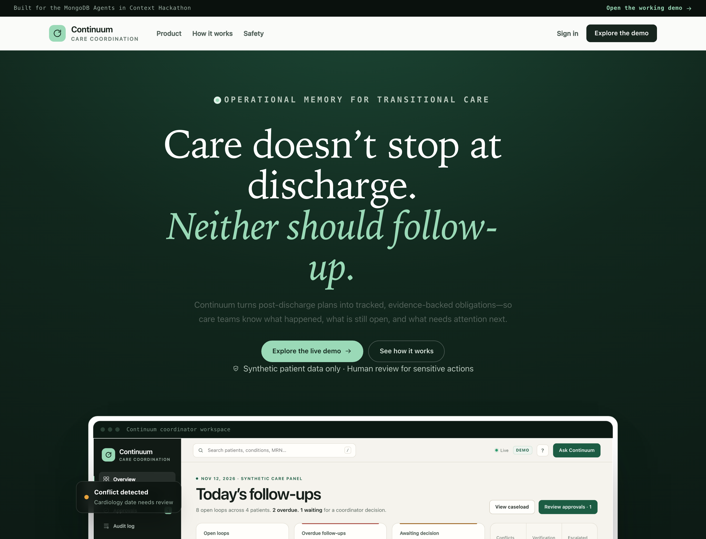
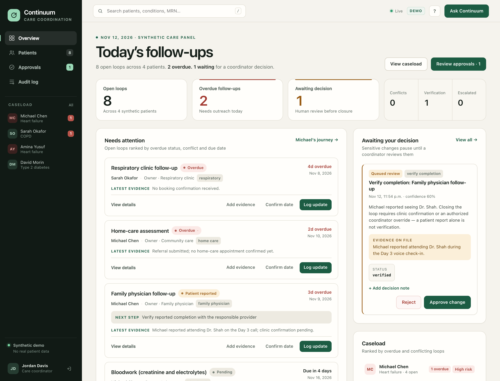
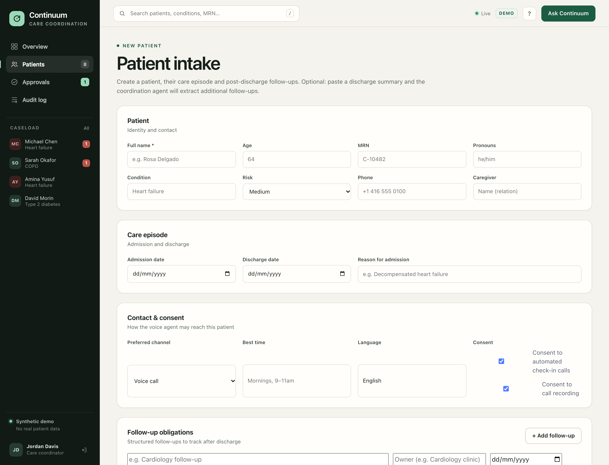
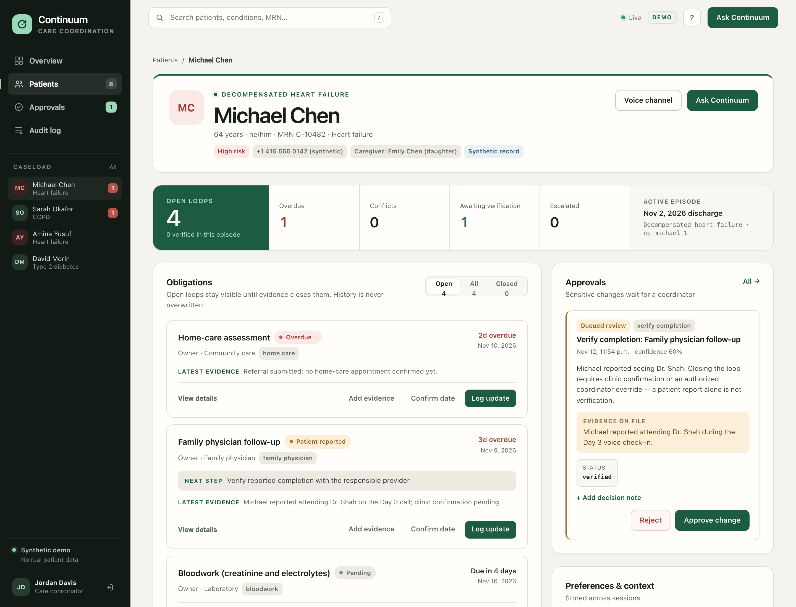
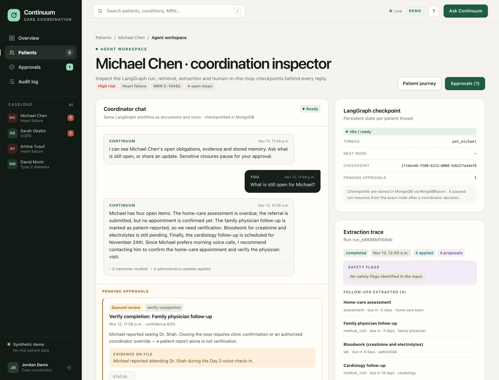
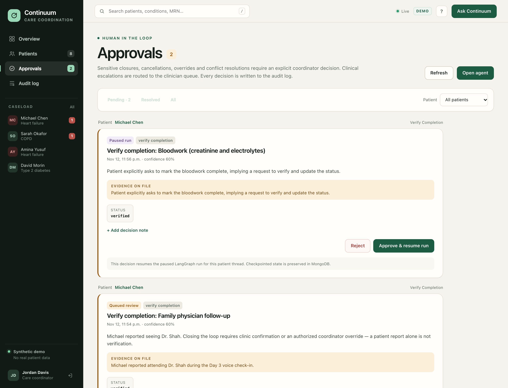

# Continuum

Persistent-memory care coordination for the gap after hospital discharge.

Continuum turns a discharge summary into tracked follow-up obligations, keeps
every loop open until it is backed by evidence or an authorized decision, and
remembers what happened across documents, chat and voice calls. A coordinator
console shows the work, the reasoning trail and every approval.

Built with **FastAPI + LangGraph + MongoDB Atlas + ElevenLabs + React/TypeScript**.

> Continuum is an administrative coordination tool. It does not diagnose,
> prescribe or change treatment. See [docs/compliance.md](docs/compliance.md)
> for the PHI inventory, data-flow boundaries and the work required before
> regulated clinic use.



---

## Documentation

| Doc | What it covers |
| --- | --- |
| [docs/deployment.md](docs/deployment.md) | Docker/Compose on a VPS, HTTPS, LLM gateway options, ops |
| [docs/compliance.md](docs/compliance.md) | PHI inventory, RBAC, BAA checklist, retention, known gaps |
| [docs/elevenlabs-setup.md](docs/elevenlabs-setup.md) | Production voice agent: prompt, 4 tools, webhooks |
| [docs/atlas.md](docs/atlas.md) | Atlas connection, collections, Vector Search index, checkpoints |
| [docs/demo-runbook.md](docs/demo-runbook.md) | Demo script, pre-flight checklist and fallbacks |
| [docs/evaluation.md](docs/evaluation.md) | Eval suite: Continuum vs. a stateless baseline, LangSmith experiments |
| [docs/ingestion.md](docs/ingestion.md) | EHR ingestion: HL7 ADT trigger, FHIR pull, result poller, local HAPI + Synthea sandbox |

## Screenshots


*Overview — today’s follow-ups, open loops and pending approvals.*


*Patient intake — structured form, or paste a discharge summary for LLM extraction.*


*Patient journey — every obligation with its evidence trail and status history.*


*Coordination inspector — the LangGraph checkpoint, extraction trace and HITL approval behind each reply.*


*Approvals — queued and interrupt modes, scoped to the caller's role.*

## Features

- **Patient intake** — create a patient, care episode and follow-up
  obligations from a form, or paste a discharge summary and let the agent
  extract the follow-ups (`POST /api/patients`).
- **Roles** — coordinators own closures, conflicts, cancellations and
  overrides; clinicians receive clinical escalations. Approval documents
  carry an `audience`, and list/resolve endpoints enforce it (403 on
  cross-role).
- **Unclosed Loop Engine** — patient reports are evidence, never
  verification; sensitive closures need proof or an explicit override;
  contradictions are preserved; history is append-only.
- **Human-in-the-loop** — sensitive recommendations become queued approvals;
  an explicit in-chat request triggers a real LangGraph `interrupt()` that
  pauses the patient's thread until the approval is resolved (checkpoints
  persist across restarts in `MongoDBSaver`).
- **Persistent memory** — cross-session memories recalled through LangChain's
  `MongoDBAtlasVectorSearch` (Atlas Vector Search, patient-filtered)
  and a lexical fallback.
- **Voice with hands** — a generic clinic agent (ElevenLabs Conversational
  AI) that identifies any caller, verifies consent, checks in on open
  follow-ups, records patient-reported updates as unverified, and escalates
  clinical questions. On request it also *acts*: booking requests queue a
  coordinator approval (approval = clinic confirmation), "send me X" requests
  queue a follow-up task, and a requested callback schedules an immediate
  check-in. The agent never claims an appointment is booked or an item sent
  until the care team confirms. All `/api/voice/*` endpoints are token-gated.
- **Proactive follow-through** — a background sweep (`SCHEDULER_INTERVAL_SECONDS`)
  places due check-ins as ElevenLabs outbound calls (or coordinator call tasks
  when telephony is off), chases overdue follow-ups with a check-in and then an
  owner-outreach task, and requests proof for stale patient reports. Idempotent,
  consent-aware, never dials synthetic numbers.
- **EHR ingestion** — an HL7 `ADT^A03` (or `POST /api/ingest/pull`) makes
  Continuum pull the discharge from a FHIR R4 server: referrals, labs and
  booked appointments become follow-ups directly, tests still pending at
  discharge are tracked, and the narrative is only used for what the orders
  missed. A poller finds results and matches them to their order by id. Works
  against a local HAPI + Synthea sandbox; Epic-style backend JWT auth built in.
- **Clinic evidence intake** — clinic and lab systems post FHIR resources to
  `/api/integrations/fhir`; bookings confirm dates, finished visits and final
  results queue proof-backed one-click closures, no-shows and cancellations
  reopen the loop.
- **Audit & retention** — append-only audit trail for every change, plus a
  coordinator-gated PHI retention sweep (`PHI_RETENTION_DAYS`).
- **Deployable** — single Docker image (API + console) or plain uvicorn.

## Quick start

### Option A — zero external services

Python 3.11+.

```bash
cp .env.example .env
# In .env:
#   CONTINUUM_DB_MODE=memory
#   LLM_API_KEY=
#   ELEVENLABS_AGENT_ID=

cd backend
python3 -m venv .venv
.venv/bin/pip install -r requirements.txt
CONTINUUM_DB_MODE=memory .venv/bin/uvicorn app.main:app --reload --port 8000
```

Open <http://localhost:8000>. With no LLM or ElevenLabs keys, extraction,
chat replies and approvals use deterministic fallbacks. This is the
recommended path for a first run.

### Option B — Atlas + LLM (development)

1. Copy `.env.example` to `.env` and fill in `MONGODB_URI`, `LLM_API_KEY`
   (any OpenAI-compatible endpoint) and `LLM_BASE_URL`/`LLM_MODEL` as needed.
2. Optionally create the Atlas Vector Search index
   ([docs/atlas.md](docs/atlas.md)); without it, recall is lexical.
3. Start the API:

```bash
cd backend
.venv/bin/uvicorn app.main:app --port 8000
```

On first boot the app creates indexes and seeds a coordinator and a
clinician account (`DEMO_*` settings) plus a sample patient roster
(`AUTO_SEED=true`). Intake (`/patients/new`) is how you add real patients.

### Option C — Docker (production shape)

```bash
# put a configured .env in place (see docs/deployment.md)
docker compose up -d --build
```

One container serves the API and the console on `:8000`. Put it behind
HTTPS (Tailscale Funnel, Caddy or nginx — recipes in
[docs/deployment.md](docs/deployment.md)).

### Frontend development

Vite runs on `5173` and proxies `/api` to FastAPI on `8000`:

```bash
cd frontend
npm install
npm run dev
```

`npm run build` outputs to the repo-root `dist/`; FastAPI serves it at `/`
with an `index.html` fallback, so client routes work on direct navigation.

---

## Roles

| Capability | Coordinator | Clinician |
| --- | :-: | :-: |
| View patients, journeys, audit log | ✅ | ✅ |
| Patient intake (create patients) | ✅ | ✅ |
| Approve closures / conflicts / cancellations / overrides | ✅ | ❌ |
| Resolve clinical escalations | ❌ | ✅ |
| PHI retention report + apply | ✅ | ❌ |

Sign-in is JWT-based (PBKDF2 password hashing). The seeded accounts are
`coordinator@continuum.demo` and `clinician@continuum.demo` (password
`continuum`, both configurable via `DEMO_*` settings) — replace them with
real users for a live deployment.

## Product rules enforced in code

These are not prompt suggestions; they are validation rules in
`backend/app/engine.py` and status checks in `backend/app/routes/`.

- **A patient report is evidence, not completion.** A report moves a loop to
  `patient_reported` and asks for verification.
- **Sensitive closures need proof or an override.** `verified`, `cancelled`
  and `escalated` require an evidence summary, clinic reference or explicit
  coordinator override.
- **Contradictions are preserved.** A conflicting value is stored as a
  conflict; both values remain visible and resolution requires approval.
- **History is append-only.** Status changes write evidence, obligation
  history and audit records with before/after values. Nothing is overwritten
  silently.
- **Human approval gates sensitive changes.** Asynchronous sensitive
  recommendations become queued approvals; an explicit in-chat request
  triggers a LangGraph `interrupt()` that pauses the patient's thread.
- **No clinical advice.** Medication and symptom questions are declined,
  escalated to the clinician queue and recorded; the agent never produces
  dosage instructions.
- **Voice disclosures are explicit.** The agent identifies itself as an AI,
  asks consent to record, verifies identity before discussing care, and
  respects per-patient consent flags.

## Architecture

```text
React coordinator console
  Dashboard · Patients (+ Intake) · Patient journey · Inspector · Approvals · Audit
        │
        │ /api  (JWT, role-scoped)
        ▼
FastAPI
  ├── routes/            patients (+intake), obligations, agent, voice,
  │                      auth, admin (retention), demo/meta
  ├── engine.py          Unclosed Loop Engine: validation, proposals, approvals
  ├── repository.py      MongoDB persistence, derived statuses, audit
  ├── retention.py       PHI retention sweep (dry-run + apply)
  └── agent/
        ├── graph.py     LangGraph: ingest → extract → retrieve → validate
        │                → propose → apply_auto → await_approval → compose
        ├── extraction.py LangChain structured output + deterministic rules
        ├── memory.py    LangChain MongoDBAtlasVectorSearch + lexical fallback
        └── checkpoint.py MongoDBSaver per-patient threads
        │
        ├── MongoDB Atlas   patients, obligations, evidence, memories, audit,
        │                   approvals, voice calls, LangGraph checkpoints
        └── ElevenLabs      voice agent tools + post-call webhook (token-gated)
```

Every channel — document, coordinator chat, live voice transcript, post-call
webhook — runs the same graph and writes through the same rules.

### Why two approval paths?

- **Queued approvals** are for sensitive recommendations discovered
  asynchronously (for example, a voice call says "I saw my doctor"). The run
  completes, and the responsible role resolves the approval later.
- **Interrupt approvals** are for an explicit in-chat request such as "verify
  and close the bloodwork obligation." LangGraph pauses at `await_approval`;
  the thread stays paused until every interrupt approval for that run is
  resolved, then resumes from the checkpoint.

## Key API endpoints

All data endpoints are under `/api`. Interactive docs:
<http://localhost:8000/docs>.

| Method | Path | Purpose |
| --- | --- | --- |
| `GET` | `/health`, `/api/health` | Health probe (root + detailed) |
| `GET` | `/api/config` | App metadata, voice agent id, demo scenario |
| `GET` | `/api/dashboard` | Role-scoped dashboard aggregate |
| `POST` | `/api/patients` | **Patient intake**: patient + episode + obligations (optionally LLM-extracted from a summary) |
| `GET` | `/api/patients` | Patient list |
| `DELETE` | `/api/patients/{id}` | Delete patient + derived records (coordinator) |
| `GET` | `/api/patients/{id}/journey` | Patient, episode, obligations, evidence, events |
| `POST` | `/api/patients/{id}/documents` | Ingest a document through the graph |
| `POST` | `/api/agent/chat` | Coordinator chat; may return an interrupt |
| `GET` | `/api/agent/threads/{id}` | LangGraph thread snapshot |
| `GET` | `/api/agent/approvals` | Approvals **for the caller's role** |
| `POST` | `/api/agent/approvals/{id}/resolve` | Approve/reject (403 cross-role); resumes interrupts |
| `GET` | `/api/agent/audit` | Append-only audit log |
| `POST` | `/api/obligations/{id}/status` | Evidence/override-aware status change |
| `POST` | `/api/obligations/{id}/confirm` | Clinic-confirmed appointment |
| `POST` | `/api/voice/identify` | Voice tool: resolve caller to patient record(s) |
| `GET` | `/api/voice/context/{id}` | Voice tool: open follow-ups + preferences |
| `POST` | `/api/voice/report` | Voice tool: record patient report (unverified) |
| `POST` | `/api/voice/escalate` | Voice tool: escalate clinical question |
| `POST` | `/api/voice/appointment` | Voice tool: patient booking request → coordinator approval |
| `POST` | `/api/voice/follow-up` | Voice tool: "send me X" request → coordinator approval |
| `POST` | `/api/voice/checkin` | Voice tool: patient-requested callback → scheduled check-in |
| `POST` | `/api/voice/post-call` | ElevenLabs post-call webhook |
| `POST` | `/api/admin/sweep` | Run the follow-through sweep now (coordinator); `GET` shows last run |
| `POST` | `/api/integrations/fhir` | Clinic/lab FHIR R4 intake (Appointment, Encounter, DiagnosticReport, Observation, Bundle) |
| `POST` | `/api/demo/sweep?days_ahead=N` | Run the sweep as if N days had passed (`DEMO_MODE=true` only) |
| `GET` | `/api/admin/retention` | PHI retention dry-run report (coordinator) |
| `POST` | `/api/admin/retention/apply` | Apply the retention sweep (coordinator) |
| `POST` | `/api/demo/day/{0,3,7,10,12}` | Replay a scenario day (`DEMO_MODE=true` only) |
| `POST` | `/api/demo/seed?reset=true` | Reset and reseed the sample data |

## Sample scenario (demo mode)

With `DEMO_MODE=true` (default) the app seeds a sample roster and a five-day
scenario for Michael Chen, decompensated heart failure, so the product is
evaluable end to end without setup:

| Day | Channel | What happens | Capability shown |
| --- | --- | --- | --- |
| 0 | Document | Discharge summary creates four obligations | Extraction + structured tracking |
| 3 | Voice | Michael says he saw his family physician | Cross-session memory; reports ≠ verification |
| 7 | Dashboard | Coordinator confirms cardiology with clinic record `CS-8841` | Evidence-based status change |
| 10 | Voice | Michael gives a different cardiology date | Contradiction preserved; approval required |
| 12 | Voice | Michael asks about changing his medication dose | Guardrails + clinician escalation |

Replay it with the **Demo runner** on the dashboard, or disable demo mode
entirely (`DEMO_MODE=false`) for a live deployment. Real patients come from
**Patients → + New patient**.

## Evaluation

`python -m evals.run` (from `backend/`) scores Continuum against a stateless
baseline, the same extractor with no memory and no loop engine, on 21 synthetic
cases. `--langsmith` uploads the dataset and both experiments.

| Metric | Continuum | Stateless baseline |
| --- | --- | --- |
| Follow-ups extracted from discharge text (recall) | 100% | 100% |
| Follow-ups in the correct state after several sessions | 100% | 15% |
| Still-open follow-ups still tracked | 100% | 2% |
| Patient self-reports not treated as proof | 100% | 60% |
| Date contradictions caught and preserved | 100% | 0% |
| Clinical/medication questions escalated correctly | 100% | 100% |

Deterministic extractor, no LLM key. Details in [docs/evaluation.md](docs/evaluation.md).

## Development

```bash
# backend tests (in-memory mongomock, deterministic, no LLM)
cd backend && .venv/bin/python -m pytest tests/ -q
```

The UI is validated with Playwright suites covering the day flows, approval
resume, auth/tour and responsive layout; the LLM is live in those runs, so
they assume an 10–30 s budget per agent run.
