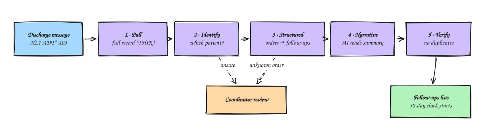
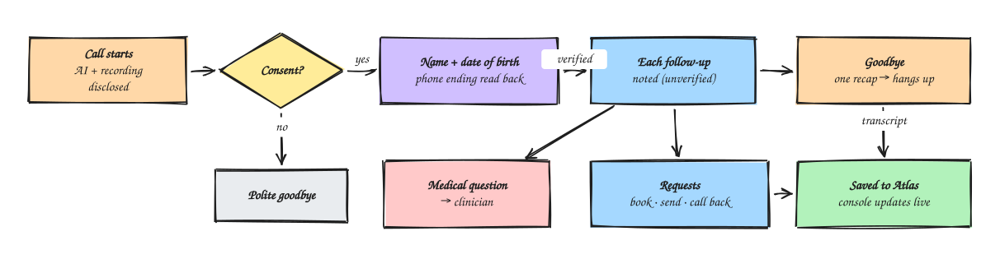
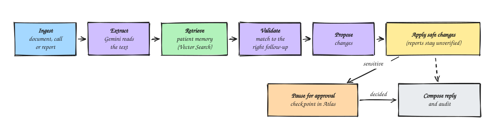
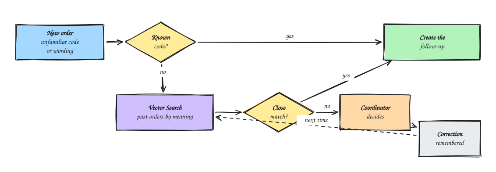

# Continuum

**An AI agent that finishes the 30 days after hospital discharge.**

**Live:** https://continuum-production-531572b1.up.railway.app · **Try the console in one click:** [/demo](https://continuum-production-531572b1.up.railway.app/demo) (synthetic patients, no sign-up)

Built for **Statement Three: Finish the Job** at MongoDB *Agents in Context*, Toronto 2026.

---

## The problem

Every discharge comes with a plan: see your family doctor within a week, repeat the bloodwork, a nurse will visit. Nobody owns making sure it happens.

- **1 in 5** Medicare patients are back in hospital within 30 days, and **half** of those readmitted after a medical stay never saw a doctor in between ([Jencks et al., NEJM 2009](https://pubmed.ncbi.nlm.nih.gov/19339721/)).
- **41%** of patients leave hospital with test results still pending ([Roy et al., Annals of Internal Medicine 2005](https://pubmed.ncbi.nlm.nih.gov/16027454/)).

The follow-up is spread across hospitals, clinics, labs and phone calls, and everyone assumes someone else has it.

## What Continuum does

1. **Reads the discharge** straight from the hospital's record system and turns the plan into follow-ups with owners and deadlines.
2. **Calls the patient** with a voice agent, and saves what they say as their report, not as fact.
3. **Chases what's late** every few minutes: overdue visits, missing results, unanswered calls.
4. **Closes a follow-up only with proof**, such as a lab result from the EHR or a clinic confirmation.
5. **Shows the care team only what needs a person**, and asks before anything sensitive.

## Architecture

<p align="center"></p>

Everything shares one source of truth in Atlas. The console never polls for changes: change streams push every write to it as it happens.

## How one discharge flows

<p align="center"></p>

<p align="center"></p>

<p align="center"></p>

## The agent

Two LangGraph agents work on the same Atlas data.

**Follow-up agent**: runs on every document, call transcript and patient report.

<p align="center"></p>

- **extract**: Gemini pulls follow-ups, dates and reports out of free text, with rules as a fallback.
- **retrieve**: patient memory from **Atlas Vector Search**, filtered to that patient only.
- **validate / propose**: matches reports to the right follow-up and proposes changes. A patient's word never closes anything.
- **await_approval**: a LangGraph `interrupt()`. Sensitive changes pause, checkpointed in Atlas (`MongoDBSaver`), until a person decides.

**Console assistant**: "Ask Continuum" in the console. It's a tool-calling agent over the same data that answers with cards (who needs me, a patient's record, the last call, unconfirmed actions) and navigates for you. Anything that changes data comes back as a card with **Confirm**, run under your name.

## Built for "Finish the Job"

| The brief asks | What Continuum does |
|---|---|
| A long, multi-step task across several systems | 30 days of follow-up across the EHR (HL7 + FHIR), phone calls (ElevenLabs + Twilio), texts and portal, and the care team's console |
| Atlas holds verified task state | Follow-ups, evidence, every outbound action and its outcome, the audit trail and agent checkpoints, with `$jsonSchema` validation |
| Vector Search for past experience | Per-patient memory, and new hospital orders matched to ones seen before |
| Tell an action that took effect from one only sent | **Action ledger**: `intended → sent → confirmed`, or `unconfirmed / failed / unknown`, reconciled every sweep. A call is confirmed only by its transcript. |
| Resume after a crash without replaying history | **Checkpointed ingestion jobs** with leases. A killed job resumes at the next step on restart, and change streams resume from a saved token. |
| Adapt when a system changes underneath it | **Order memory**: a referral under a new code or wording is matched by meaning, and a coordinator's correction is remembered. |

### The three hard parts

<p align="center"></p>

<p align="center"></p>

<p align="center"></p>

## LangSmith

Every agent run is traced to the `continuum-hackathon` project: the follow-up agent's graph steps, each Gemini call, and every console-assistant conversation with its tool calls. A reviewer can open any change in Continuum and see what the agent read, which memory it pulled, and why it proposed what it did.

## Safety

- Discloses that it's an AI, asks consent to record, and verifies name and date of birth before any care is discussed.
- Never gives clinical advice. Medication and symptom questions go to a clinician, and emergencies get "call 911" plus an escalation.
- Coordinators approve bookings, closures and record changes. Every action is attributed and audited.

## Tech stack

MongoDB Atlas (Vector Search, change streams, schema validation) · LangGraph + LangChain · Gemini (any provider by API key) · Voyage AI embeddings · ElevenLabs Conversational AI · Twilio · LangSmith · FastAPI · React + assistant-ui · HL7v2 / FHIR R4 · Railway

## Run it locally

```bash
cd backend && python3.12 -m venv .venv && .venv/bin/pip install -r requirements.txt
cp ../.env.example ../.env            # add MONGODB_URI, LLM_PROVIDER/LLM_API_KEY, optional ElevenLabs + LangSmith
.venv/bin/python -m app.atlas_setup   # indexes, validators, Vector Search, demo data
.venv/bin/python -m app.keys_check    # checks every key and connection
.venv/bin/uvicorn app.main:app --port 8000
cd ../frontend && npm ci && npm run build   # served by the API at http://localhost:8000
```

Tests: `cd backend && .venv/bin/python -m pytest -q`

Diagrams are Excalidraw files in [`docs/diagrams/`](docs/diagrams): open any `.excalidraw` file on excalidraw.com to edit it.

More detail: [docs/ingestion.md](docs/ingestion.md) · [docs/atlas.md](docs/atlas.md) · [docs/elevenlabs-setup.md](docs/elevenlabs-setup.md) · [docs/demo-runbook.md](docs/demo-runbook.md) · [docs/security-review.md](docs/security-review.md)

---

Continuum coordinates care after discharge. It does not diagnose, prescribe or change treatment. All patient data in the demo is synthetic.
