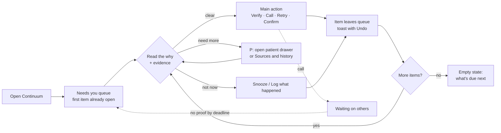

# Continuum console redesign

**Start here: [`proposal/index.html`](proposal/index.html)** (open in a browser). It covers who the users are, research, gaps, style, logo, text sizes, layout and breakpoints, header and search, sliders and dragging, states, and every page today vs. proposed (screenshots in `proposal/current/` and `proposal/new/`). The prototype now includes sign-up, team, settings, a physician view and phone/tablet layouts.

**Earlier: v2 "One queue".** Clickable prototype: [`prototype/index.html`](prototype/index.html) (open it in a browser; no build step).

v2 replaces v1 after review feedback: *too much information, too many colours, no hierarchy, no design system, no user flow or interaction model.* v1 (the "Ward ledger" Figma frames, §1–§7 below) is kept for the audit, the content and the provenance/ledger rules. **Its colours, page layouts and navigation are superseded by v2.**

---

## v2.1 What changed and why

| Problem in v1 | v2 answer |
| --- | --- |
| Every screen is a dense table; all rows look equally important | **One thing in focus at a time.** A queue on the left, one item open on the right, one main action. |
| Five status colours, chips, tone bars, coloured counts | **Two colours: ink and red.** Red only means *overdue* (or a value outside its range). Everything else is weight, position and wording. |
| Seven nav destinations the coordinator has to check (Today, Decisions, Ingestion, Ledger, Identity…) | **One inbox, "Needs you".** Anything that needs a person (overdue follow-up, proof to verify, result to review, unknown call, failed import, identity question) lands in the same queue. Ingestion, ledger and audit become *Activity*, a place to check, not a place to work. |
| Provenance tags on every line | **Sources are one click away** ("Sources and history", collapsed). The detail says it in plain words first. |
| No defined flow | The **core loop** below, built and working in the prototype. |

## v2.2 Hierarchy

Every screen has exactly three levels. If something doesn't fit one of them, it doesn't go on the screen.

| Level | What | How it's shown |
| --- | --- | --- |
| 1. Focus | The item you're deciding on: title, the one-paragraph "why", the evidence you need, **one** primary button | 26 px title, 16 px explanation, ink primary button, sticky at the bottom |
| 2. Queue | What's next, in order (overdue first, then oldest) | 14 px rows: title, patient, when. Red dot + red "4 days overdue" only when overdue |
| 3. Context | Navigation, patient details, sources, history, waiting and done items | Muted text, collapsed sections, drawers |

## v2.3 The core loop (user flow)



- **Arrival.** The first item is already open. No dashboard to read first.
- **Decide.** Each item answers three questions in this order: *what is it* (title), *why is it here* (one paragraph, plain words), *what do I need to see* (the evidence block, only what the decision needs).
- **Act.** One primary action (Enter). Secondary actions are outline buttons. Destructive or uncertain choices are never the primary.
- **Next.** The item animates out (220 ms), a toast confirms with **Undo** (6 s, or U), and the next item opens. Calls move the item to *Waiting on others*; if the proof (transcript, clinic record) doesn't arrive by its deadline, it returns to *Needs you* by itself.
- **Done for now.** Empty state says what's due next, so nobody has to go looking.

Secondary flows: **look up a patient** (Patients → drawer, or P from any item) and **check what the system did** (Activity → Calls and tasks / Imports / Audit log). Neither is needed in the daily loop.

## v2.4 Interaction model

| Element | States |
| --- | --- |
| Queue row | default · hover (canvas tint) · selected (grey fill) · overdue (red dot + red time) · leaving (fade + 12 px slide, off under reduced motion) |
| Primary button | default (ink) · hover · focus ring (blue, 2 px) · disabled while an action runs |
| Call in progress | inline panel in Focus: Intended → Sent → Confirmed with times; buttons disabled; then item moves to Waiting |
| Log / Not enough proof | inline text box in Focus, Save / Cancel; Esc leaves the field |
| Toast | after every action, with Undo; one at a time |
| Patient drawer | slides from the right (180 ms), scrim behind, Esc or click outside closes, focus moves to Close |
| Sources and history | collapsed `<details>` in every item |
| Empty queue | message + the next due item |

Keyboard: **J/K** move, **Enter** main action, **P** patient, **U** undo, **Esc** close, **?** help. Every action is also a visible button.

## v2.5 Design system

**Tokens** (replace the v1 colour block in §4; type, spacing and radius from §4 still apply):

```css
:root{
  --bg:#F6F5F2; --surface:#FFFFFF; --sunken:#EFEEEA; --selected:#E9E8E3;
  --line:#E2E0DA; --line-strong:#C4C1B9;
  --ink:#18191B; --ink-2:#45484D; --muted:#5E6167;   /* muted ≥4.9:1 on every light surface, including the selected row */
  --red:#B42318; --red-bg:#FBEDEB;                    /* overdue / out-of-range only */
  --focus:#2F5BD3;                                     /* keyboard focus ring only */
  --on-ink:#FFFFFF;
}
:root[data-theme="dark"]{
  --bg:#121315; --surface:#1A1C1F; --sunken:#0E0F11; --selected:#25272B;
  --line:#2C2F33; --line-strong:#43464C;
  --ink:#ECEDEE; --ink-2:#C2C5CA; --muted:#9A9DA3;
  --red:#FF8F80; --red-bg:#35100C; --focus:#86A6F5; --on-ink:#121315;
}
```

**Type:** 26/32 bold (focus title) · 20/26 bold (queue and page titles) · 16/1.55 (the "why") · 14/1.5 (body, rows) · 13 (secondary) · 12 (labels, hints) · mono 12 for times, record numbers, lab codes. Fonts unchanged (Atkinson Hyperlegible Next + Mono).

**Components** (all in the prototype):

| Component | Used for |
| --- | --- |
| `AppShell` | 200 px nav · 380 px queue · flexible focus pane |
| `QueueRow` | one item: dot, title, patient, when |
| `QueueGroup` | collapsible "Waiting on others" / "Done today" |
| `FocusHeader` | patient link + context, title, status line |
| `Why` | one paragraph, max 62 characters wide |
| `EvidenceBlock` | label + content; variants: key-value, compare (ordered vs came back, or two identities), quote, single value |
| `ActionBar` | sticky; one primary, up to two secondary, keyboard hint |
| `LiveAction` | inline progress for calls (intended → sent → confirmed) |
| `InlineNote` | text box for log / not enough proof |
| `Sources` | collapsed record references and history |
| `Toast` | confirmation + Undo |
| `PatientDrawer` | everything about one patient, grouped Needs you / Waiting / Done |
| `PlainTable` | Patients and Activity only |

**Item types → main action:** overdue follow-up → *Call* · proof arrived → *Verify and close* · result back → *Send to attending* · unknown order code → *Confirm type* · identity question → two equal buttons (*Same person, merge* / *Different people*) · unknown call → *Call again* · failed import → *Retry*.

**Rules:** one primary button per screen · red only for overdue and out-of-range values · no chips, tone bars or coloured counts · absolute times (09:06, Nov 13) · every item says *why* in a sentence before showing data · sources collapsed, never removed.

## v2.6 Every page, mapped to today's app

All of these are in the prototype, using only the components and tokens above. Navigation: **Needs you · Patients · Add a discharge · Activity (Calls and tasks, Imports, Identity checks, Audit log)**.

| Prototype page | Replaces (today) | What changed |
| --- | --- | --- |
| Welcome (`#/welcome`) | `Landing.tsx` | One column: one sentence, 4 numbered lines, Sign in / Explore. No hero, gradient or floating cards. |
| Sign in (`#/login`) | `Login.tsx` | Form + one plain sentence. Demo buttons "As care coordinator / As clinician". |
| Needs you (`#/queue`) | `Dashboard.tsx`, `ApprovalsPage.tsx` | Dashboard and Approvals merge into one queue. Filters **All · Overdue · To verify · System** replace the separate Approvals page. |
| Patients (`#/patients`) | `PatientsPage.tsx` | Table instead of cards: search, filters All / Needs you / Overdue, one red dot for overdue. |
| Patient (`#/patients/:id`) | `PatientJourney.tsx`, `Timeline.tsx`, `ObligationCard.tsx` | Tabs **Follow-ups · History · How decisions were made**. Follow-ups grouped Needs you / Waiting / Done; a Needs-you row jumps to that item in the queue. Contact and consent on the right. |
| How decisions were made (tab) | `Inspector.tsx`, `ChatPanel.tsx`, `MemoryPanel.tsx` | Chat with the assistant about this patient, then in plain words: what it understood, what it checked, what it proposed, what it remembered. Graph, checkpoint and thread ids are under "Technical details". |
| Call panel (drawer from "Call …") | `VoiceWidget.tsx` | Connecting → live transcript → ended, with the intended / sent / confirmed track and what was taken from the call. |
| Log update (drawer) | Log update modal | Who told you + what they said; recorded as a report, not proof. |
| Add a discharge (`#/new`) | `PatientIntake.tsx` | Two choices: import from the hospital record (recommended) or enter by hand. By hand is 4 numbered sections; "Find follow-ups" suggests follow-ups you tick before creating. |
| Calls and tasks (`#/activity/calls`) | new: action ledger | Table + detail with the track. Filters All / Didn't work / In progress / Confirmed. Items needing a person link to Needs you. |
| Imports (`#/activity/imports`) | new: ingestion jobs | Table with 5-step progress, detail list per step, "picked up after a restart" explained in words, Retry from the failed step. |
| Identity checks (`#/activity/identity`) | new: identity review | Open check with the comparison and two equal buttons; decided checks below. |
| Audit log (`#/activity/audit`) | `AuditPage.tsx` | Patient filter + search; click a row for record, before and after. |

## v2.7 Status

- Prototype: all 13 pages built; every page and its main interactions checked in the browser with no script errors. Not tested with a coordinator. The real React app is unchanged.
- Figma: not updated to v2 (Starter plan MCP limit). The v1 frames show the old colour system; update them from the prototype when Figma access returns.

---

# v1 "Ward ledger" (superseded colours and layouts)

Figma: **[Continuum — Console redesign](https://www.figma.com/design/wXLsJuJEhQz9HZDZORbnKs)**

| Page / frame | Link | State |
| --- | --- | --- |
| Foundations: type, colour tokens (light + dark), spacing, chips, buttons, provenance, ledger | [node 5:2](https://www.figma.com/design/wXLsJuJEhQz9HZDZORbnKs?node-id=5-2) | done |
| Component sources: `StatusChip`, `Button`, `ProvenanceTag`, `LedgerState` | [node 3:2](https://www.figma.com/design/wXLsJuJEhQz9HZDZORbnKs?node-id=3-2) | done |
| 01 Today (dashboard: caseload + needs attention) | [node 6:71](https://www.figma.com/design/wXLsJuJEhQz9HZDZORbnKs?node-id=6-71) | done |
| 02 Patient journey (follow-ups, evidence, EHR provenance, timeline, ledger) | [node 7:108](https://www.figma.com/design/wXLsJuJEhQz9HZDZORbnKs?node-id=7-108) | done |
| 03 Decisions (one-click verify with clinic evidence) | [node 8:182](https://www.figma.com/design/wXLsJuJEhQz9HZDZORbnKs?node-id=8-182) | done |
| 04 Ingestion (EHR jobs: step progress, resumed-from, failures) | [node 8:372](https://www.figma.com/design/wXLsJuJEhQz9HZDZORbnKs?node-id=8-372) | done |
| 05 Action ledger (intended / sent / confirmed / failed / unconfirmed / unknown) | [node 9:220](https://www.figma.com/design/wXLsJuJEhQz9HZDZORbnKs?node-id=9-220) | done |
| 06 Identity review (side-by-side merge / keep separate) | [node 9:616](https://www.figma.com/design/wXLsJuJEhQz9HZDZORbnKs?node-id=9-616) | built, not screenshot-checked |
| 07 Login, plus a dark-mode copy of 01 Today | — | **pending**: see below |

**Pending:** the Figma Starter plan hit its MCP call limit before Login and the dark Dashboard were built.
[`figma/pending-login-and-dark.js`](figma/pending-login-and-dark.js) builds both. Run it once with `use_figma` on the file after the limit resets.
The Login spec is also written out [below](#07-login), so implementation does not wait on it.
Exported PNGs of the finished frames are in [`figma/`](figma/). `01-today.png` and `02-patient-journey.png` were exported before two small text fixes; the Figma file has the fixed versions.

---

## 1. Audit of today's console

Screenshots: [`audit/`](audit/). Captured from http://localhost:8000 on 14 Nov 2026.

### What reads as generic / "AI slop"

1. **Landing and login are template heroes.** Dark green radial-gradient hero, concentric-circle decoration, glassmorphism "proof" card, italic serif accent phrase ("*Neither should follow-up.*"), mono uppercase kicker with a glowing dot, announce bar, floating cards, "trust" strip. Each of these on its own is common, and together they look like a generated SaaS landing page.
2. **Mono all-caps eyebrow + big serif headline on every page** ("NOV 14, 2026 · SYNTHETIC CARE PANEL" / *Today's follow-ups*; "HUMAN IN THE LOOP" / *Approvals*; "APPEND-ONLY TRAIL" / *Audit log*). It's decoration, and the eyebrow copy is vague.
3. **KPI card row.** Four big-number cards with coloured top borders (Open loops 8, Overdue 2, Awaiting decision 3, plus a mini Conflicts/Verification/Escalated box). They take 140 px to say one sentence, and the colour is decorative because it is applied to the card, not to the items.
4. **Card soup.** Every follow-up is a 16 px-radius card with four equal-weight actions (View details / Add evidence / Confirm date / Log update). About 4 items fit on screen. Every card is equally loud, so nothing stands out.
5. **Chip overload.** Status pill + category pill ("bloodwork") + risk pill + "Queued review" + "follow up" on the same item. Avatar initials tinted red/green/amber by risk add more colour that means nothing new.
6. **The same approval card in four places** (Dashboard, Patients, Journey, Inspector) with no change in density or context.
7. **AI is the hero.** "Ask Continuum" is the primary button in the global top bar, "Ask agent" sits on every patient card, and a whole "coordination inspector" page shows the LangGraph checkpoint. That belongs in a debug drawer, not the coordinator's main path.
8. **Soft everything.** 16 px radius, soft drop shadows, warm-paper + evergreen everywhere, page-load fade-in animations (screens are half-transparent for a moment on every navigation).
9. **Copy that sells instead of saying.** "Operational memory for transitional care", "Every care commitment, accounted for.", "Human in the loop".

### What works (keep)

- **Restrained palette.** No purple/teal. A single accent and paper neutrals: the new direction keeps the calm and changes what the colour means.
- **Explicit status vocabulary** (Overdue, Patient reported, Scheduled, Pending) and a **"Latest evidence"** line on each item, which is the right provenance instinct.
- **Concrete operational copy** inside items: "Referral submitted; no home-care appointment confirmed yet."
- **Caseload in the left rail** with overdue counts.
- **Audit log as a real table.**
- **Approve / Reject with a decision note.** The human gate is visible.

---

## 2. Two directions

### A. Ward ledger (chosen)

A paper chart, not an app. Warm light-grey canvas, white working surfaces, near-black ink, hairline rules instead of cards and shadows. Information is set as **tables and lists grouped by urgency**, at 13 px base with two-line 52 px rows (36 px compact). Typeface: **Atkinson Hyperlegible Next** for reading, **Atkinson Hyperlegible Mono** for identifiers, times and record references. It was designed by the Braille Institute for low-vision readers, so it is distinct from Inter and has a reason to exist in a clinical tool, where I/l/1 and 0/O confusion in MRNs and lab values matters. Colour is **only** status: red overdue, amber needs-your-decision, green verified, slate in-progress, grey open/unknown. Each status also has a **shape** (dot, diamond, check, half-dot, ring, dashed ring). Provenance is **typographic**: a small EHR / AI / PT / CC badge plus the mono record reference.
*Mood:* type Atkinson Next + Mono · colour ink on paper with 4 status hues · density high, calm · corners 2/4/6 px · no shadows.

### B. Night desk

A control room: dark-first, condensed type (IBM Plex Sans Condensed + Plex Mono), very dense 28 px rows, status as filled cells like a monitoring board, a persistent split view (list left, detail right) on every page, keyboard-first. It would suit a coordinator running a big caseload on a large monitor.
*Mood:* type Plex Condensed + Mono · colour charcoal with saturated status cells · density very high · corners 0–2 px.

### Why A

Coordinators and clinicians use this **all day, in bright wards, often on shared and older monitors**, and many are not power users. A light, high-contrast, larger-x-height reading surface is safer for long sessions and for printing or screen-sharing with a clinic. B's density and dark-first look read as "ops tooling", which raises the bar for clinicians who join occasionally to sign off. A keeps B's best ideas instead: grouped tables, keyboard shortcuts on decisions (`J/K`, `V`, `N`), a list + detail layout where it earns it (Decisions), and a **full dark theme** generated from the same semantic tokens.

---

## 3. Anti-slop rules (apply to every screen)

1. **No gradients, glows, glass, blobs, or decorative circles.** Surfaces are flat colours from tokens.
2. **No KPI cards.** Summaries are a sentence with inline counts: "8 open follow-ups across 4 patients. ● 2 overdue ◆ 3 need your decision ◑ 3 waiting on proof". Counts are links to the filtered list.
3. **Colour means status, and nothing else.** No coloured avatars, coloured section borders, tinted card tops or "brand" colour on headings. The only coloured button is green **Verify & close**, because it is the one action that marks something verified.
4. **Every status has a shape as well as a colour** (see glyphs in §5). The screen must still read in greyscale.
5. **One chip per row.** The row's 3 px left rule carries the same tone. Categories ("bloodwork", "pharmacy") are plain text in the owner line, not chips.
6. **One primary button per region.** Secondary actions are outline; tertiary are quiet text buttons. Row actions show the single *next* step ("Call clinic", "Verify", "Review"), not every possible action.
7. **No icon-per-bullet, no emoji, no illustration.** Icons only where a symbol beats a word (search, close). The nav is text with counts.
8. **No all-caps mono eyebrows or serif display headlines.** Page title = 24 px semibold, followed by one line of plain explanation.
9. **Say what is true, in the coordinator's words.** "Call 08:30 unconfirmed: no transcript", not "AI-powered outreach". Times are absolute (`09:06`, `Nov 13 10:30`). Relative time only for queue age ("16 h").
10. **Every fact shows its source** with a `ProvenanceTag`: EHR resource + version, AI extraction (dashed, "confirm before closing"), patient-reported, coordinator-entered.
11. **AI is a tool, not the hero.** "Ask Continuum" is a quiet button in the top bar. Agent internals (LangGraph checkpoint, extraction trace) move to a collapsible "How this was decided" drawer on the follow-up, not a page in the main nav.
12. **No entrance animations** on navigation. Motion only for state change (a row moving groups after a decision: 150 ms, respects `prefers-reduced-motion`).
13. **Radius 2 / 4 / 6 px. No shadows** on resting surfaces; one shadow token for popovers and the command palette only.
14. **Delete the marketing landing from the authenticated flow.** `/` goes to Login (or Today if signed in). If a public page is needed for the hackathon, it uses the same tokens and the Login layout, no hero.

---

## 4. Tokens (drop into `frontend/src/styles.css`)

Replaces the `:root` block at the top of `styles.css`. Old names are mapped at the bottom so existing rules keep working during migration; delete the aliases screen by screen.

```css
/* Fonts: Google Fonts (OFL). For hospital networks, self-host the same files. */
@import url("https://fonts.googleapis.com/css2?family=Atkinson+Hyperlegible+Mono:wght@400;500;600&family=Atkinson+Hyperlegible+Next:ital,wght@0,400;0,500;0,600;0,700;1,400&display=swap");

:root {
  /* ── Colour · light ─────────────────────────────── */
  --bg-canvas: #F4F3EF;
  --bg-surface: #FFFFFF;
  --bg-sunken: #ECEAE4;      /* table headers, quiet wells */
  --bg-selected: #E6EAF1;    /* selected row, active nav */

  --text-primary: #16181B;
  --text-secondary: #3E4249;
  --text-muted: #62666E;     /* ≥4.77:1 on every light background */
  --text-inverse: #FFFFFF;
  --text-link: #23439B;

  --border-subtle: #DEDBD3;  /* row rules, panel outlines */
  --border-strong: #B9B5AB;  /* inputs, outline buttons, quote rule */
  --border-focus: #2F5BD3;

  --action-primary-bg: #16181B;
  --action-primary-fg: #FFFFFF;

  --status-overdue-fg: #B42318;  --status-overdue-bg: #FCEDEB;  --status-overdue-border: #EFC2BC;
  --status-decision-fg: #8A5300; --status-decision-bg: #FDF2DA; --status-decision-border: #E9CE92;
  --status-verified-fg: #1E6B3C; --status-verified-bg: #E6F3EA; --status-verified-border: #B7DABF;
  --status-progress-fg: #34557F; --status-progress-bg: #E9EFF7; --status-progress-border: #C2D1E6;
  --status-neutral-fg: #565A61;  --status-neutral-bg: #EFEEEA;  --status-neutral-border: #C9C6BE;

  /* ── Type ───────────────────────────────────────── */
  --font-sans: "Atkinson Hyperlegible Next", system-ui, -apple-system, "Segoe UI", sans-serif;
  --font-mono: "Atkinson Hyperlegible Mono", ui-monospace, "SF Mono", Menlo, monospace;
  --text-page: 600 24px/30px var(--font-sans);      /* letter-spacing: -0.2px */
  --text-section: 600 16px/22px var(--font-sans);
  --text-row-title: 600 14px/20px var(--font-sans);
  --text-body: 400 13px/20px var(--font-sans);      /* base size */
  --text-body-strong: 600 13px/20px var(--font-sans);
  --text-small: 400 12px/16px var(--font-sans);
  --text-column: 500 12px/16px var(--font-sans);    /* table headers, sentence case */
  --text-chip: 600 11px/14px var(--font-sans);      /* letter-spacing: 0.1px */
  --text-data: 400 12px/16px var(--font-mono);      /* ids, times, values */
  --text-data-small: 400 11px/14px var(--font-mono);/* record references */
  --text-count: 600 20px/24px var(--font-sans);

  /* ── Space, size, shape ─────────────────────────── */
  --space-1: 4px; --space-2: 8px; --space-3: 12px; --space-4: 16px;
  --space-5: 24px; --space-6: 32px; --space-7: 48px;
  --row-h: 52px;            /* two-line row */
  --row-h-compact: 36px;    /* single-line row */
  --control-h: 32px;
  --input-h: 34px;
  --rail-w: 224px;
  --topbar-h: 48px;
  --radius-chip: 2px; --radius-control: 4px; --radius-panel: 6px;
  --tone-rule: 3px;         /* left rule on rows */
  --shadow-popover: 0 8px 24px -8px rgba(22, 24, 27, 0.25);  /* popovers + palette only */

  color-scheme: light;
  color: var(--text-primary);
  background: var(--bg-canvas);
  font: var(--text-body);
  font-variant-numeric: tabular-nums;
}

/* ── Colour · dark (same names) ─────────────────── */
:root[data-theme="dark"] {
  --bg-canvas: #111315; --bg-surface: #191C20; --bg-sunken: #0C0E10; --bg-selected: #232A35;
  --text-primary: #ECEDEE; --text-secondary: #C4C7CC; --text-muted: #989CA3; --text-inverse: #111315; --text-link: #9DB4F5;
  --border-subtle: #2A2E34; --border-strong: #3D424A; --border-focus: #7C9CF0;
  --action-primary-bg: #ECEDEE; --action-primary-fg: #111315;
  --status-overdue-fg: #FF9C8F;  --status-overdue-bg: #3B1814;  --status-overdue-border: #6B2A22;
  --status-decision-fg: #F3C46A; --status-decision-bg: #33260C; --status-decision-border: #634A17;
  --status-verified-fg: #7BD3A0; --status-verified-bg: #10301E; --status-verified-border: #23573A;
  --status-progress-fg: #A9C2E8; --status-progress-bg: #182436; --status-progress-border: #2E4566;
  --status-neutral-fg: #A9ADB4;  --status-neutral-bg: #1F2226;  --status-neutral-border: #3A3E44;
  --shadow-popover: 0 8px 24px -8px rgba(0, 0, 0, 0.6);
  color-scheme: dark;
}
@media (prefers-color-scheme: dark) {
  :root:not([data-theme="light"]) { /* copy the [data-theme="dark"] block here */ }
}

/* ── Migration aliases: delete as each screen is converted ── */
:root {
  --paper: var(--bg-canvas); --paper-2: var(--bg-sunken); --surface: var(--bg-surface); --surface-2: var(--bg-sunken);
  --ink: var(--text-primary); --ink-2: var(--text-secondary); --muted: var(--text-muted);
  --line: var(--border-subtle); --line-strong: var(--border-strong);
  --red: var(--status-overdue-fg); --red-soft: var(--status-overdue-bg);
  --amber: var(--status-decision-fg); --amber-soft: var(--status-decision-bg);
  --green: var(--status-verified-fg); --green-soft: var(--status-verified-bg);
  --blue: var(--status-progress-fg); --blue-soft: var(--status-progress-bg);
  --purple: var(--status-neutral-fg); --purple-soft: var(--status-neutral-bg);
  --rail: var(--bg-surface); --rail-text: var(--text-primary); --rail-muted: var(--text-muted);
  --shadow: none; --shadow-sm: none;
  --radius: var(--radius-panel); --radius-sm: var(--radius-control);
  --font-display: var(--font-sans);
}
```

Note: today `--green` is both the brand accent and "verified". In the new system the action colour is ink (`--action-primary-bg`), and green only means verified. Grep for `var(--green` in buttons and links when migrating.

### Contrast (WCAG 2.1, computed)

| Pair | Light | Dark |
| --- | --- | --- |
| text-primary on canvas | 16.0 | 15.9 |
| text-secondary on surface | 10.1 | 10.1 |
| text-muted on canvas / sunken / selected | 5.2 / 4.8 / 4.8 | 6.8 on canvas |
| text-link on surface | 9.0 | 8.4 |
| overdue fg on bg | 5.8 | 7.8 |
| decision fg on bg | 5.7 | 9.1 |
| verified fg on bg | 5.7 | 8.0 |
| progress fg on bg | 6.6 | 8.6 |
| neutral fg on bg | 6.0 | 7.1 |
| Verify button (inverse on verified-fg) | 6.5 | 10.4 |
| Primary button | 17.8 | 15.9 |

All pass AA for 11–13 px text (4.5:1). Focus ring: 2 px `--border-focus`, offset 2 px, on every interactive element.

---

## 5. Components

Figma component names in `code`. Each spec gives the anatomy, tokens and rules an implementation needs.

### Status glyphs (shared)

10×10 inline SVG, `currentColor`. Used inside chips, group headers, rail, timeline and ledger.

| Tone | Glyph | Meaning |
| --- | --- | --- |
| overdue | filled dot | past due, no proof |
| decision | filled diamond (hollow diamond = ledger *unconfirmed*) | waiting on a person |
| verified | check | proof + sign-off |
| progress | half-filled ring | booked / sent / pending result |
| neutral | ring | open, nothing due yet / intended |
| unknown | dashed ring | the system cannot tell |
| failed | ✕ (overdue colour) | channel said no |

```html
<!-- paths, viewBox 0 0 10 10 -->
dot:      <circle cx="5" cy="5" r="4" fill="currentColor"/>
diamond:  <path d="M5 .8 9.2 5 5 9.2 .8 5Z" fill="currentColor"/>
check:    <path d="M1.4 5.3 4 7.8 8.7 2.4" fill="none" stroke="currentColor" stroke-width="1.8" stroke-linecap="round" stroke-linejoin="round"/>
half:     <circle cx="5" cy="5" r="3.9" fill="none" stroke="currentColor" stroke-width="1.2"/><path d="M5 1.1A3.9 3.9 0 0 1 5 8.9Z" fill="currentColor"/>
ring:     <circle cx="5" cy="5" r="3.9" fill="none" stroke="currentColor" stroke-width="1.2"/>
dashed:   <circle cx="5" cy="5" r="3.9" fill="none" stroke="currentColor" stroke-width="1.2" stroke-dasharray="2 1.7"/>
x:        <path d="M2 2 8 8M8 2 2 8" fill="none" stroke="currentColor" stroke-width="1.8" stroke-linecap="round"/>
```

### `StatusChip`

- Inline-flex, gap 5 px, padding 3 px 7 px 3 px 6 px, radius 2 px, 1 px border, `--text-chip`.
- Tone → `bg` / `border` / `fg` from the status tokens. `unknown` = transparent bg, **dashed** neutral border.
- Label states the fact, not the category: "Overdue 2d", "Verify visit", "Prelim: no growth 48h", "Scheduled 10:30", "Patient reported".
- Max one per row. Never used for category or risk.
- Map from `ObligationStatus`: `overdue`→overdue · `escalated`→overdue · `conflict`→decision · `patient_reported`→progress ("Patient reported") · `attempted`→progress · `scheduled`→progress · `pending`→neutral ("Open"/"Ordered") · `verified`→verified · `unknown`→unknown · `cancelled`→neutral (struck row, muted). Any item with a pending approval shows decision ("Verify visit", "Review result").

### `Button`

- Height 32 px, padding 0 12 px, radius 4 px, `--text-body-strong`, no shadow.
- `primary`: ink bg, inverse text. `secondary`: surface bg, `--border-strong` border. `quiet`: text only, underline on hover. `verify`: `--status-verified-fg` bg, inverse text, **only** for sign-off. `danger`: surface bg, overdue text + border (Reject, Discard).
- One primary per region. Keyboard hint shown next to decision buttons in `--text-data-small` muted ("V to verify").

### `ProvenanceTag`

- Row: source badge + mono reference, gap 6 px, `--text-data-small`, reference in `--text-muted`.
- Badge, mono semibold 11 px, padding 1 px 4 px, radius 2 px:
  - `EHR`: solid `--text-secondary` bg, inverse text. Reference = `ResourceType/id · vN` plus who/when ("ServiceRequest/sr-88213 · v2 · ordered by Dr. A. Patel, Nov 4").
  - `AI`: transparent, **dashed** `--border-strong`. Reference says what it read and whether a person confirmed it ("from discharge summary ¶4 · confirmed by J. Davis Nov 5"). Until confirmed, append "confirm before closing".
  - `PT`: outline. Patient-reported, with call id and time.
  - `CC`: outline. Coordinator-entered, with name and time.
- Maps to backend: `origin: ehr_structured` → EHR (from `fhir_refs`), `ai_extracted` → AI, evidence `kind` patient_report → PT, manual → CC. Reference text is clickable to the evidence record.

### `LedgerState` and the track

- Glyph + label, gap 6 px, `--text-body-strong` in the tone colour: intended (ring, neutral), sent (half, progress), confirmed (check, verified), failed (✕, overdue), unconfirmed (hollow diamond, decision), unknown (dashed ring, neutral).
- **Track** = the states an action passed through, left to right, each with its timestamp underneath in `--text-data-small` muted. Only states that happened are shown; the current one is last. No connecting progress bar.

### Shell

- **Rail** 224 px, `--bg-surface`, 1 px right rule. Top: "Continuum" (16/22 semibold) and the unit ("St. Mary's · Cardiac step-down") in small muted. Nav: text items 30 px tall, radius 4 px, active = `--bg-selected` + semibold. Count on the right in mono; tinted with a status colour only when it needs action (Decisions, Ingestion failures, Ledger needs-a-person, Identity review). Order: Today, Patients, Decisions, Ingestion, Action ledger, Identity review, Audit log.
- **Caseload** under nav: name + "HF · day 10", with the patient's worst status glyph (8 px) on the left. No initials avatars.
- Rail footer: user name, role, "Synthetic data only" in mono small.
- **Top bar** 48 px, canvas bg, bottom rule: breadcrumb left (last crumb semibold); right: search field 300×30 ("Find patient, MRN, follow-up" + `/` hint), live indicator (half glyph + "Live · synced 09:14:02" mono small; switches to overdue dot + "Reconnecting…" when SSE drops), quiet "Ask Continuum".
- **Body** padding 24 px 32 px 32 px; sections 20 px apart. Page header = title (24 px) + optional mono timestamp on the same baseline + one explanatory line in secondary. Page-level actions right-aligned on the header baseline.

### Panel

`--bg-surface`, 1 px `--border-subtle`, radius 6 px, no shadow. Optional 44 px header: title semibold left, muted meta right, bottom rule. Panels hold tables and lists; never nest panels in panels (use a rule instead).

### Table, row, group header

- Header row: `--bg-sunken`, `--text-column` muted, sentence case, 7 px vertical padding, bottom rule.
- **Row**: 3 px left tone rule (`--status-*-fg`, transparent if none) + cells with 12 px horizontal / 8–10 px vertical padding; bottom 1 px `--border-subtle`. Cell = primary line (body or body-strong) + secondary line (small muted, or mono small for ids). Selected row = `--bg-selected`. Hover = `--bg-sunken` at 50 %.
- **Group header** inside a table: glyph + "Overdue · 2" in the tone colour (body-strong) + a muted sentence saying what to do ("Chase today. Calls already attempted are shown in the ledger."). Groups in fixed order: Overdue → Needs your decision → Waiting on proof → Open → Closed.
- Numbers, dates, ids and lab values are mono. Dates absolute ("Nov 12"); the second line gives the relative fact in tone colour only when it matters ("2 days overdue").

### Timeline item

Three columns: date gutter 52 px (mono "Nov 13" over muted "16:41"), glyph column (10 px glyph, 1 px `--border-subtle` line down to the next item), content (title body-strong, detail small secondary, source mono small muted). Newest first. Only events that change what someone should do (status changes, proof, calls, ingestion), not every audit row.

### Evidence block (on a follow-up)

Inside the selected follow-up row: 1 px subtle border, radius 4 px, padding 14 px.
1. "Proof received" + `ProvenanceTag` of the incoming record.
2. The excerpt as a quote: 1 px `--border-strong` left rule, 12 px padding, secondary text, attribution at the end.
3. Three facts in a row (label small muted, value mono small): **Match** ("Encounter.basedOn → sr-88213 (exact id)"), **Closes**, **Also cancels**.
4. Actions: `verify` "Verify & close", `secondary` "Not enough proof", `quiet` "Open in EHR", hint "V to verify".

### Ordered vs Came back (compare)

Two equal columns separated by a 1 px rule. Each: title + `ProvenanceTag`, then label/value rows (label 96 px small muted, value body). A value that differs from the requirement is in decision colour ("Nov 13 10:30 · day 9 (2 days late)"); the matching id is in verified colour. Under it: the clinic note quote, then a numbered "Verifying will" list of side effects. Closing late is recorded, not hidden.

### Step bar (ingestion)

Five 30×8 px segments, gap 3 px, radius 1 px, for `pull · identify · structured · narrative · verify`. done = verified-fg fill; running = progress-bg fill + progress-fg border; failed = overdue-fg fill; paused = decision-fg fill; waiting = `--border-strong` outline; skipped (duplicate) = dashed outline. `title` attribute / tooltip names the step and time. Job detail lists steps vertically: glyph, step (mono), time (mono muted), what it did. Any restart is its own line in overdue colour ("Process exited after structured. Lease of pid 48211 reclaimed by pid 48390 at 09:13:40"). A **Resumed from** callout (progress-bg, 1 px progress-border left rule) states which steps were *not* re-run.

### Field compare (identity review)

Four columns: Field 150 / Existing 250 / Incoming 250 / Result 150, each column header carrying the record's `ProvenanceTag`. Result = glyph + "Same" (verified), "Differs" (overdue, whole row tinted `--status-overdue-bg`), "Similar" (progress), "Missing" / "No shared id" (neutral), plus a muted note ("Day and month swapped?"). Below: a sunken "Why this is paused" line quoting the rule.

### Inputs

34 px, surface bg, 1 px `--border-strong`, radius 4 px, placeholder muted. Label above in `--text-column` secondary. Required reason fields say "(required)" in the label, not with an asterisk.

---

## 6. Screen by screen

Implement in this order: tokens → shell → Today → Patient journey → Decisions → Action ledger → Ingestion → Identity review → Login → remove landing.

### 01 Today (`pages/Dashboard.tsx`)

- Header: "Today" + mono date/time. Summary sentence with inline status counts (links). Actions: secondary "Add discharge", primary "Start calls (n)" (only when there are callable overdue items).
- Left: **Worklist** panel (856 px at 1440). Tabs: All open · Mine · Overdue · Decisions · Closed this week, each with a mono count. Columns: tone · Patient (name + "C-10482 · HF · d10") · Follow-up (title + owner) · Due (date + relative) · Status · proof (chip + one line of proof) · Next (one button). Grouped by urgency.
- Right: **Since 08:00** activity panel (FILL): last ~6 events from the action ledger and ingestion, each with time, sentence, source line. "Full ledger →".
- Remove: KPI cards, the Approvals column (decisions are a group in the worklist), the Caseload card (it's in the rail).

### 02 Patient journey (`pages/PatientJourney.tsx`, `components/ObligationCard.tsx`, `components/Timeline.tsx`)

- Header: name (24 px) + mono "64 · he/him · DOB · MRN"; one line of clinical context; a facts row (Readmission risk in overdue colour only if high, Caregiver, Best reached, Consent). Actions: secondary "Log update", primary "Call patient".
- Tabs: Follow-ups · Timeline · Action ledger · Discharge packet · Audit.
- Left 700 px: **Follow-ups** list. Each row: tone rule, title + owner, due (mono) + chip, `ProvenanceTag` of where the follow-up came from, optional one-line note. Selected row expands the **Evidence block**. Verified items stay in the list, dimmed, at the bottom.
- Right: **Timeline** panel then **Action ledger** panel (last 3 with tracks).
- Remove: KPI strip, the duplicate Approvals column, avatar.

### 03 Decisions (`pages/ApprovalsPage.tsx`, `components/ApprovalCard.tsx`)

- Rename "Approvals" → **Decisions** in nav and title.
- Queue (340 px): kind in decision colour ("Verify completion", "Review result", "Confirm order type", "Approve outbound call"), title, patient, source; queue age top-right mono. Link to identity reviews at the bottom.
- Detail: question as title ("Close "Cardiology follow-up ≤ 7 days" for Michael Chen?"), proposer line in mono, **Ordered vs Came back** compare, clinic note, "Verifying will" list, note field, actions `verify` / `secondary` "Not enough proof" / `quiet` "Reassign…", signer line. Keyboard: J/K, V, N.
- **Order-type confirmation** (console-features session) uses the same detail: Ordered = the unrecognized order (code, display text, `ProvenanceTag` EHR); Came back = the proposed classification with how it was matched ("same code seen before" / "vector match 0.81 over past orders" / "word overlap"), and the follow-up it will create. Buttons: primary "Confirm as BMP", secondary "Choose another type…", quiet "Leave unrecognized".

### 04 Ingestion (new, console-features)

- Header + explanation; actions "Poll results now", "Pull a discharge…".
- Status strip (4 cells): EHR connection, Result poller, HL7 listener, Needs attention.
- Jobs table: tone · Job (mono) · Patient (+ MRN) · Message (type + control id) · Steps (step bar) · State (chip: Running · resumed / Paused · identity / Completed / Failed at verify / Duplicate · ACK AA / Matched) · Started (mono) · Outcome (sentence; failed rows get secondary "Resume from verify").
- Selected job detail: per-step list + **Resumed from** callout. Links to raw HL7 and the pulled FHIR bundle as quiet buttons.

### 05 Action ledger (new, console-features)

- Header + legend of the six states with "Unknown actions are never retried automatically."
- Tabs: Today · Needs a person · In flight · Confirmed · Calls only.
- Groups: **Needs a person** (unconfirmed, unknown, failed) → **In flight** → **Confirmed today**.
- Columns: tone · Action (id mono + kind) · What (who + purpose) · Track · Proof (what was expected and what happened) · State chip · one button (Check / Resolve / Fix / Open).

### 06 Identity review (new, console-features)

- Title is the question: "Is this the same person?" + explanation; source job/message on the right.
- **Field compare** (800 px) + **Decide** panel: two options, each with what it will do (bullets) and its own button (primary "Merge records", secondary "Keep separate"), then a required reason field and quiet "Call caregiver to confirm DOB".

### 07 Login (`pages/Login.tsx`)

- Split 720 px | rest. Left on canvas: wordmark + "Care coordination console" top-left; form (380 px) vertically centred: "Sign in" (24 px), "Use your hospital account.", Work email, Password, primary full-width "Sign in", divider "or explore with synthetic patients", two secondary buttons side by side "As care coordinator" / "As clinician", muted note "Demo mode shows synthetic patients only. No real patient information." Bottom-left mono small: build + EHR connection status.
- Right on surface with a left rule: one sentence in 16 px semibold ("A follow-up stays open until there is proof and a person signs it off.") then four ruled label/value lines (Follow-ups, Proof, Actions, Decisions). No gradient, illustration, testimonial or floating card.

### Other pages

- **Patients** (`PatientsPage.tsx`): a table, not cards. Columns: worst-status tone · Patient · Condition · Day · Open · Overdue · Waiting on you · Next due · Owner. Filters as the same tab row as Today.
- **Audit log** (`AuditPage.tsx`): keep the table, apply table spec; action column is plain text, not chips; time column mono at full contrast (today it's light grey).
- **Inspector** (`Inspector.tsx`): remove from nav. Becomes a drawer "How this was decided" on a follow-up or decision (extraction, retrieved memories, checkpoint) in mono, for clinicians and judges who want to look.
- **Command palette / hotkey help / modals**: the only places with `--shadow-popover`; radius 6 px.
- **Landing** (`Landing.tsx`): remove from the signed-out default route (see rule 14).

---

## 7. Content used in the frames (synthetic)

Michael Chen (64, HFrEF, discharged Nov 4 from St. Mary's 5W; cardiology referral ServiceRequest/sr-88213 seen Nov 13 Encounter/enc-5521; BMP verified Nov 8; blood culture pending, prelim no growth 48 h; home-care assessment overdue; medication review furosemide 40→80 mg + spironolactone). Sarah Okafor (COPD, respiratory clinic overdue, call unconfirmed). Amina Yusuf (HF, day 1, BMP K⁺ 5.4 mmol/L (H), unrecognized order LAB-ZZ-114). David Morin (T2D, HbA1c). Robert Alvarez (resumed ingestion job). Grace Thompson (failed verify step). Incoming "Michael Chen" H-77310 with DOB 1962-08-03 vs 1962-03-08 for identity review. All synthetic.
